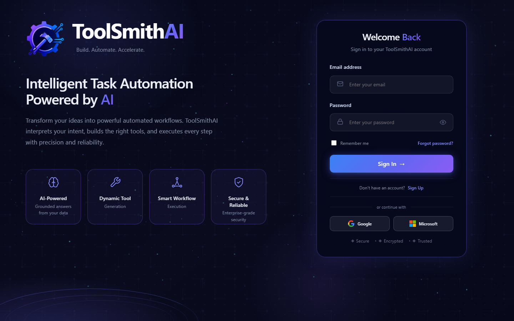

# ToolSmithAI

**Built by Harpreet Kaur.**

ToolSmithAI lets business users ask questions about connected Microsoft SQL Server databases or uploaded CSV/Excel datasets in plain language. It discovers and profiles metadata, retrieves relevant schema evidence with embeddings, generates read-only SQL through the AI-first fast path, validates the SQL, executes it against current data, and returns tables, KPIs, grounded insights, and charts.

## Product preview



## Why this exists

Important business information is often locked behind database schemas, SQL
knowledge, and analyst availability. A basic text-to-SQL demo can make that
information easier to reach, but it can also select the wrong tables, invent a
join, or generate an unsafe statement. ToolSmithAI was created to give
non-technical decision-makers a simpler way to explore organizational data
without treating model-generated SQL as trusted code.

## Who it is for

- Business and operations leaders who need answers but do not write SQL.
- Analysts who want a faster, reviewable starting point for recurring questions.
- Data teams that need natural-language access with deterministic safety checks.
- Organizations working with SQL Server databases and ordinary CSV/Excel files.

## Positive impact

ToolSmithAI reduces the distance between a business question and a useful,
current answer. It combines plain-language access with safeguards that make the
result easier to trust:

- Users receive understandable tables, KPIs, grounded insights, and appropriate
  charts instead of raw SQL alone.
- Relevant schema evidence is retrieved with embeddings, reducing the amount of
  irrelevant database structure sent to the model.
- Generated SQL is parsed and checked against known tables, columns, joins, and
  safety rules before execution.
- Ambiguous questions produce clarification instead of a confident guess.
- Repeated questions can skip model calls, while validation and live SQL
  execution still run so the returned business data remains current.
- Database sources and uploaded files share one consistent workspace, reducing
  the need for separate technical tools.

## What I built

Harpreet Kaur designed and implemented the consolidated product experience and
its AI-first data-question pipeline: connection-time metadata preparation,
embedding retrieval, guarded SQL generation, deterministic validation, live
execution, clarification and follow-up handling, persistent validated-plan
caching, answer/insight/chart formatting, exports, testing, and the React user
experience. Historical experiments remain archived for engineering traceability;
they are not presented as active product routes.

## Demonstrated engineering results

| Evidence | Verified result |
| --- | --- |
| Full backend regression suite | 6,520 passed, 9 intentionally skipped, 0 failed |
| Frontend component suite | 175 passed, 0 failed |
| Frontend lint and production build | Passed |
| Python dependency audit | No known vulnerabilities |
| npm dependency audit | 0 vulnerabilities |
| CI backend smoke subset | 154 passed |

These figures describe engineering verification, not business accuracy. Live
answer quality and latency depend on the connected database, its metadata, the
configured model, and network conditions.

## What is included

- SQL Server connection, discovery, structural profiling, and view intelligence
- AI-first natural-language question answering for connected SQL sources
- Vector/embedding retrieval for relevant schema and business evidence
- Deterministic SQL safety validation before every execution
- Persistent validated-plan cache; cached plans are revalidated and SQL is re-executed
- Follow-up question context and clarification flows
- CSV and Excel upload/report workflows
- CSV, Excel, and PDF export
- Optional report email delivery and scheduled workflows
- React web interface and FastAPI backend

Runtime databases, credentials, uploaded files, exports, logs, dependency folders, backups, and generated validation results are intentionally excluded from Git.

## Current architecture

```text
User question
  -> React AI Workspace
  -> POST /v1/composer/ask
  -> source/dataset selection
       SQL source
         -> vector retrieval of schema + business evidence
         -> one AI-first intent/schema/SQL generation call
         -> relationship completion and deterministic validation
         -> live read-only SQL execution
         -> deterministic table/KPI/insight/chart formatting
       CSV or Excel dataset
         -> dataset report and analysis pipeline
  -> answer, evidence, export, and follow-up state
```

The retired keyword intent router and legacy multi-agent SQL execution path are not part of the active composer route.

## Requirements

- Python 3.12
- Node.js 20 or newer
- Microsoft ODBC Driver for SQL Server when connecting to SQL Server
- An OpenAI API key for AI-first SQL question answering

## Try it in five minutes without CCPP

1. Complete the backend and frontend setup below.
2. Generate the five local secrets using the commands documented in
   `.env.example`; keep them only in your untracked `.env` file.
3. Start both services and register a local test user.
4. Open **Data Sources**, upload a non-sensitive CSV or Excel file, and select it
   from the AI Workspace.
5. Use the SQL Server flow only when you have an authorized, non-production test
   connection and an OpenAI key.

The private demonstration database is not required to review the interface,
uploaded-dataset workflow, repository structure, or automated tests.

## Local setup

### 1. Backend

```powershell
python -m venv .venv
.\.venv\Scripts\Activate.ps1
python -m pip install -r requirements.txt
Copy-Item .env.example .env
```

Edit `.env` with your own secrets and feature configuration. Never commit `.env`.

Before the first backend start, replace every `your-...` placeholder. At a
minimum, configure `JWT_SECRET`, `ENCRYPTION_KEY`, `USER_ID_SALT`,
`ADMIN_API_KEY`, and `USER_API_KEY`. `.env.example` includes safe generation
commands. The backend intentionally refuses to start with a missing or weak
JWT secret.

For backend development and testing, install the additional test dependencies:

```powershell
python -m pip install -r requirements-dev.txt
```

Start the API:

```powershell
python -m uvicorn api.app:app --reload --host 127.0.0.1 --port 8000
```

The application creates its local SQLite metadata database on first startup. For a durable location outside the repository, set `TOOLSMITH_DATA_DIR` in `.env` before starting.

### 2. Frontend

In a second terminal:

```powershell
Set-Location frontend
npm ci
npm run dev
```

Open `http://localhost:5173`. Vite proxies `/v1` requests to the backend at `http://127.0.0.1:8000`.

## Configuration

Use `.env.example` as the supported configuration template. At minimum, configure secure values for authentication/encryption and provide `OPENAI_API_KEY` when enabling AI functionality.

### Enable database question answering

The AI-first SQL path is deliberately disabled for newly cloned installations.
Connect a SQL Server database first and wait for its automatic discovery and AI
preparation to complete. Open the database summary on the **Data Sources** page
to find its **Source ID**, then set:

```dotenv
OPENAI_API_KEY=your-key
AI_FIRST_SQL_FAST_PATH_ENABLED=true
AI_FIRST_SQL_FAST_PATH_SOURCE_IDS=123
```

Replace `123` with the displayed source ID. Multiple prepared sources use a
comma-separated list, for example `123,124`. Restart the backend after editing
`.env`. A source outside this allow-list receives a clear "not enabled" answer;
the application never falls back to an older SQL planner.

`OPENAI_MODEL` defaults to `gpt-4o-mini`. Optional fast-path model overrides in
`.env.example` are blank by default so a fresh clone does not assume access to a
model unavailable to the reviewer's OpenAI account. The private CCPP demo used
an explicitly configured reasoning model; that local configuration is not
committed.

### Optional validated-plan caches

```dotenv
AI_FIRST_SQL_FAST_PATH_PLAN_CACHE_ENABLED=true
AI_FIRST_SQL_FAST_PATH_DURABLE_PLAN_CACHE_ENABLED=true
```

The memory cache is cleared when the backend stops. The durable SQLite cache
survives backend and computer restarts. Both caches store validated structural
plans and SQL, not returned result rows or database credentials. SQL can contain
filter literals, so protect the metadata database like other application data.
Every hit is revalidated and executed against the live source, which keeps
business results current.

Real email delivery is optional and disabled by default.

### Private CCPP demonstration

The public repository does not include CCPP credentials, its SQL Server data,
or Harpreet's local metadata database. The CCPP demo therefore requires private
network/database access and a separately configured `.env`. A reviewer can run
the application without CCPP, connect their own SQL Server source, or use the
CSV/Excel upload workflow.

## Tests

Backend:

```powershell
python -m pip install -r requirements-dev.txt
python -m pytest tests
```

Frontend:

```powershell
Set-Location frontend
npm test
```

Tests use isolated fixtures unless a test is explicitly marked as a live integration check. Do not point automated tests at a production database.

## Repository layout

```text
api/                 FastAPI routes and response adapters
auth/                Authentication helpers
core/sqlservice/     AI-first retrieval, generation, validation, cache, and execution
core/answering/      Answer, insight, chart, and export formatting
data/                Metadata persistence and datasource services
frontend/            React/Vite web application
migrations/          Additive SQLite metadata migrations
tests/               Backend regression tests
docs/                Architecture and validation documentation
knowledge_packages/  Sanitized portable knowledge packages
```

## Data and security rules

- Generated SQL is read-only and must pass deterministic validation.
- A plan-cache hit never returns old result rows; SQL runs again against current source data.
- Raw query rows, credentials, secrets, prompts, and vectors are not stored in the durable plan cache.
- Local `.env`, SQLite files, logs, uploads, exports, and backups are not version controlled.
- Permanently deleting a datasource is distinct from disconnecting it and requires explicit confirmation in the UI.

## Docker

```powershell
docker build -t toolsmithai .
docker run --rm -p 8000:8000 --env-file .env -v ${PWD}/data:/app/data toolsmithai
```

The current Dockerfile packages the backend only. SQL Server connectivity also
uses Microsoft ODBC Driver 18 in the image. The React frontend is run separately
with Vite and is not bundled into this backend image. Local Windows setup remains
the verified demonstration path; do not describe this image as a complete
production deployment.

For defense in depth, create a dedicated SQL Server login that has permission to
read only the schemas/views needed by ToolSmithAI. The application validates every
generated statement, but database permissions should independently prevent writes.

## Known limitations

- Live database question answering currently supports Microsoft SQL Server.
- The AI-first path requires an OpenAI API key and explicit source allow-list.
- Fresh questions depend on model-provider latency; validated cache hits are faster.
- Docker, public cloud deployment, and two-computer knowledge portability need additional production validation.
- Historical validation material under `docs/validation/` records development work and is not the supported setup path.

## Production status and expansion path

ToolSmithAI is a **production-oriented prototype validated for a controlled
pilot**. It is not represented as a turnkey production deployment. Its modular
FastAPI, React, connector, retrieval, validation, and persistence boundaries
provide a practical foundation for expansion, but an organization should add
the following before serving critical or regulated workloads:

- managed secrets and key rotation;
- organization SSO, role design, and formal tenant-isolation review;
- managed application metadata storage, backups, and disaster recovery;
- centralized monitoring, alerting, tracing, and operational runbooks;
- load, concurrency, failure-recovery, and model-quality evaluation at the
  intended production scale;
- deployment automation for both backend and frontend;
- security, privacy, and data-governance approval for each connected source.

This distinction keeps the case study honest: the current system demonstrates
the architecture and safety controls needed for a pilot, while clearly naming
the operational work required for enterprise production.
